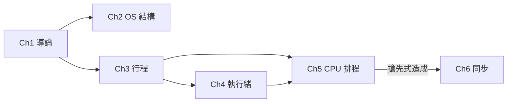

# OS 小講義--作業系統期中複習筆記網站

- 網頁：https://<帳號>.github.io/os-notes/
- 規則文件：[AGENTS.md](AGENTS.md)
- 給 AI 的導覽：[llms.txt](llms.txt)

## 專案特色

1. 首頁由 `data/lessons.json` 自動產生，不需手改 HTML。
2. 每章講義依固定範本撰寫，包含考試重點與練習題。
3. 以 `prerequisites`、`related`、`concepts.json` 描述各章邏輯關聯。

## 學習路徑



## 本機預覽

瀏覽器會擋下本機檔案的 `fetch`，請用本機伺服器：

```bash
python3 -m http.server
# 開啟 http://localhost:8000
```

## 新增一章

把提示詞交給 AI：

```
請先閱讀 AGENTS.md，再依照規則新增 lessons/os-04-threads.html。
內容來源是 sources/04_OS_ThreadsConcurrency_v1.0.pdf。
完成後更新 lessons.json、concepts.json、llms.txt，
並補上相鄰講義的連結，最後回報修改了哪些檔案。
```
